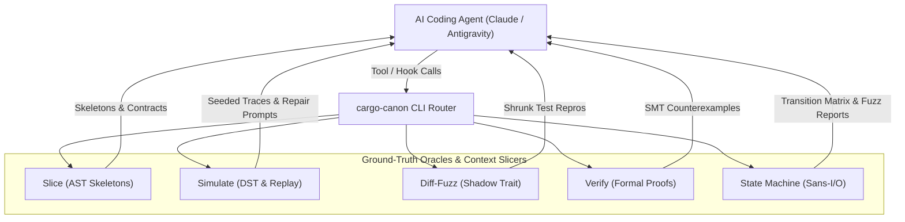

# `cargo-canon`


> **AI Ground-Truth Verification & Context Slicing Engine for Rust**

`cargo-canon` is a high-performance verification oracle and compiler-aware context delivery engine designed for large-scale Rust codebases (>1.2M LOC). It transforms AI coding agents (Claude, Antigravity, Cursor) from **unreliable open-loop generators** into **robust closed-loop engineers** by pairing them with deterministic simulation, differential fuzzing, bounded model proofs, and out-of-band type skeleton slicing.

---

## The Core Problems, Approaches & Solutions

In large codebases, AI coding assistants suffer from four systemic failure modes. Here is how `cargo-canon` approaches and solves each one:

| Failure Mode | How `cargo-canon` Approaches It | Concrete Solution in `cargo-canon` |
|:---|:---|:---|
| **1. Context Dilution & Drift** | Compiler-aware AST slicing | `syn` skeleton stripping + call-graph indexing |
| **2. Tool Hook File Desync** | Out-of-band advisory delivery | Non-destructive post-read verification |
| **3. Concurrency Flakiness** | Seeded deterministic runtime | Discrete-event DST + AI repair prompt |
| **4. Shallow Test Hallucination** | Closed-loop adversarial testing | Diff-fuzzing, Kani model proofs & `proptest` |

### 1. Context Window Dilution & Semantic Drift

- **The Problem:** Dumping raw source files into an LLM's context window leads to attention decay. The model loses track of trait bounds, drop semantics, lock hierarchies, and implicit contracts defined thousands of lines or dozens of files away, causing subtle semantic drift.
- **The Approach:** Instead of feeding raw implementation bodies to the model, extract a synthetic, compilable interface skeleton containing only the structural types, signatures, attributes, and contracts directly relevant to the task.
- **How `cargo-canon` Solves It:**
  - Employs a `syn::visit_mut::VisitMut` AST pass ([`canon-slice::skeleton`](crates/canon-slice/src/skeleton.rs)) that strips function/method bodies in sub-milliseconds while preserving visibility, struct/enum layouts, trait definitions, and doc comments.
  - Crawls call hierarchies and discovers all `impl Trait for Target` contracts across the workspace ([`canon-slice::indexer`](crates/canon-slice/src/indexer.rs)).
  - Achieves **>60%–85% token reduction**, giving the model 100% of the type and contract context with a fraction of the token consumption.

### 2. Tool Hook Desynchronization & Broken Patch Tools

- **The Problem:** Naive pre-read or post-read hooks that inject comments, annotations, or skeletons directly into target source files rewrite file contents on disk. This breaks line numbers and byte offsets, causing subsequent patch and diff editing tools (Claude Code, Antigravity) to fail with offset mismatches.
- **The Approach:** Maintain strict physical separation between on-disk target files and injected context.
- **How `cargo-canon` Solves It:**
  - Implements a **strictly non-destructive advisory tool hook** ([`canon-daemon::hook`](crates/canon-daemon/src/hook.rs)).
  - Emits all skeletons, contracts, and call hierarchies **exclusively out-of-band** (via stdout or Unix domain socket JSON-RPC).
  - Enforces a defensive post-read verification check: target source files are asserted byte-identical on disk before and after tool execution, ensuring zero offset drift.

### 3. Non-Deterministic Concurrency & Unreproducible Race Conditions

- **The Problem:** LLMs cannot mentally simulate complex async runtimes, thread schedules, mutex contention, or network packet reordering. Standard `cargo test` runs are non-deterministic and miss elusive race conditions.
- **The Approach:** Run async and distributed workflows inside a seeded, discrete-event simulation environment where simulated time, timers, scheduling, and network latency are 100% reproducible from a single 64-bit seed.
- **How `cargo-canon` Solves It:**
  - Integrates a Deterministic Simulation Testing (DST) engine ([`canon-harness::simulate`](crates/canon-harness/src/simulate/engine.rs)) with configurable fault injection (packet drop rates, latency stalls, deadlock bounds).
  - Evaluates thousands of randomized seeds in seconds (`cargo canon simulate --seeds 5000`).
  - **100% Deterministic Replay:** Any failure reproduced from its exact seed (`cargo canon simulate --seed 0xDEADBEEF`).
  - **Adversarial AI Repair Prompt:** Automatically converts the failing seed, timeline trace, and active state into an actionable repair prompt for the agent.

### 4. Shallow Unit Testing Hallucinations

- **The Problem:** When prompted to test its own code, an LLM generates superficial happy-path tests (`assert_eq!(add(2, 2), 4)`), giving a false sense of security while edge cases, integer wraparounds, and dropped invariants escape into production.
- **The Approach:** Replace shallow unit test generation with automated, mathematically rigorous ground-truth verification: differential fuzzing, bounded model checking, and algebraic metamorphic properties.
- **How `cargo-canon` Solves It:**
  - **Differential Fuzzing (`diff-fuzz`):** Wraps legacy and candidate implementations in a shadow-trait harness, checks millions of randomized operations, minimizes failing inputs, and exports standalone Rust `#[test]` reproducers.
  - **Bounded Model Checking (`verify`):** Formally proves panic-freedom and invariant adherence across all bounded symbolic inputs via Kani, parsing SMT solver outputs into formatted Rust struct initializers.
  - **Metamorphic Invariant Testing (`invariants`):** Tests universal algebraic properties (Round-trip, Idempotence, Permutation Invariance, Monotonicity) powered by `proptest`.
  - **Sans-I/O Pure State Machines (`state-machine`):** Decouples domain logic from I/O, fuzzing state transitions at **>10,000,000 transitions/second** with full reachability and dead-state analysis.

---

## Closed-Loop Verification Architecture



---

## The 6 Ground-Truth Pillars

### Pillar 1: Deterministic Simulation Testing (`simulate`)

- **Engine:** Seeded discrete-event simulator with virtual clock, message delivery queue, and fault injection.
- **Execution:** Run $N$ pseudo-random simulation passes (`cargo canon simulate --seeds 5000`).
- **Reproducibility:** Replay any specific failure deterministically (`cargo canon simulate --seed 0x081e074d89bffda5`).
- **AI Feedback Loop:** Converts timeline traces directly into repair instructions:

  ```text
  # Canon Deterministic Simulation Testing (DST) Oracle: Bug Report
  - Reproducible Seed: 0x081e074d89bffda5
  - Failure Tick: 15
  - Violation: SequenceInvariantViolated: PayloadReady received before Handshake acknowledged
  
  ## Execution Timeline Trace
  [tick 00005] FAULT INJECTED: dropped message 'HandshakeSyn' destined for actor 1
  [tick 00010] FAULT INJECTED: dropped message 'HandshakeAck' destined for actor 2
  [tick 00015] DELIVERED: 'PayloadReady' to actor 1
  ```

### Pillar 2: Differential Fuzzing Oracle (`diff-fuzz`)

- **Pattern:** Dual-run shadow trait pattern comparing legacy reference vs. candidate implementation.
- **Shrinking:** Automatically minimizes failing operation sequences down to the smallest reproducing subset.
- **Export Reproducer:** Emits a standalone, copy-pasteable Rust `#[test]` reproducer file (`--export-repro`).

### Pillar 3: Proof-Carrying Patches via Model Checking (`verify`)

- **Engine:** Invokes `cargo kani` with JSON output parsing and unwind bounds (`--unwind 4`).
- **Counterexample Synthesis:** Parses raw SMT failures into concrete Rust struct initializers detailing the exact input state that triggered the failure.
- **Scaffolding:** Generates starter `#[kani::proof]` verification stubs (`--scaffold <SYMBOL>`).

### Pillar 4: Metamorphic Invariant Synthesis (`invariants`)

- **Concept:** Replaces shallow tests with algebraic property suites:
  - *Round-trip:* $f^{-1}(f(x)) \equiv x$
  - *Idempotence:* $f(f(x)) \equiv f(x)$
  - *Permutation Invariance:* $f(\text{shuffle}(x)) \equiv f(x)$
  - *Monotonicity / State Bounds:* State counters strictly increase or decrease.
- **Scaffolding:** Emits complete `proptest` suites ready for production use (`--scaffold <SYMBOL>`).

### Pillar 5: Sans-I/O Pure State Machine Framework (`state-machine`)

- **Purity:** Pure synchronous domain transitions (`step(&mut State, Event) -> Result<Vec<Action>, Error>`) with caller-injected deterministic time. `#![no_std]` compatible.
- **Throughput:** Benchmarked at **>10,000,000 transitions/second** with zero heap allocations in steady state.
- **Reachability Analysis:** Dumps complete transition tables and flags dead/unreachable states (`--matrix`).

### Pillar 6: Compiler-Aware Context Slicing (`slice`)

- **Extraction:** Sub-millisecond type skeleton extraction using `syn`, stripping function bodies while preserving all trait bounds, visibility, and doc comments.
- **Graph Queries:** Explores upstream callers and downstream callees up to `--depth <N>`.
- **Contracts:** Extracts all `impl Trait for Target` blocks associated with the target type.
- **Prompt Bundling:** Formats LLM-ready markdown blocks with measured token reduction percentages.

---

## Installation & Quick Start

### Build and Install

```sh
# Clone repository
git clone https://github.com/your-org/cargo-canon.git && cd cargo-canon

# Build release binaries
make build

# Install into your Cargo binary directory (~/.cargo/bin)
cargo install --path crates/cargo-canon
```

Run either as a cargo subcommand (`cargo canon <COMMAND>`) or as a standalone binary (`canon <COMMAND>`).

---

## CLI Command Reference

### Context Slicing

```sh
# Stripped type skeleton (default)
cargo canon slice src/engine.rs

# Call hierarchy up to depth 3
cargo canon slice src/engine.rs --mode hierarchy --depth 3

# Trait contracts (impl Trait for Target)
cargo canon slice src/engine.rs --mode contracts

# Complete LLM-optimized bundle in Markdown
cargo canon slice src/engine.rs --mode bundle --format markdown

# Machine-readable JSON output
cargo canon slice src/engine.rs --format json
```

### Deterministic Simulation Testing

```sh
# Run 5,000 randomized simulation passes
cargo canon simulate --seeds 5000

# Replay a specific seed deterministically
cargo canon simulate --seed 0x081e074d89bffda5

# Configure fault rate and timeout bounds
cargo canon simulate --seeds 1000 --fault-rate 0.10 --max-ticks 20000

# Generate actionable prompt on failure
cargo canon simulate --seeds 5000 --ai-prompt-on-fail
```

### Differential Fuzzing

```sh
# Compare legacy vs candidate over 50,000 iterations
cargo canon diff-fuzz --target-trait KvStore --legacy LegacyMap --candidate CandidateMap --iterations 50000

# Automatically minimize and export #[test] reproducer
cargo canon diff-fuzz --iterations 10000 --export-repro tests/repro.rs
```

### Model Checking

```sh
# Run bounded proofs with loop unwinding depth 4
cargo canon verify --unwind 4

# Target specific proof harness
cargo canon verify --harness "verify_connection"

# Scaffold a starter #[kani::proof] stub
cargo canon verify --scaffold ConnectionEngine
```

### Metamorphic Invariants

```sh
# Run metamorphic property test suite
cargo canon invariants --run

# Scaffold proptest algebraic invariant suite
cargo canon invariants --scaffold TransactionCoordinator
```

### Sans-I/O State Machine

```sh
# Transition matrix and dead-state analysis
cargo canon state-machine --matrix

# Transition fuzzer (>10M transitions/sec)
cargo canon state-machine --fuzz-transitions --transitions 500000
```

### Background Daemon & Agent Hooks

```sh
# Start background IPC daemon on /tmp/canon.sock
cargo canon daemon --start

# Advisory post-read hook (source file on disk remains strictly byte-identical)
cargo canon daemon --hook-post-read --file src/engine.rs
```

---

## Configuration (`.canon.toml`)

Place a `.canon.toml` file in your repository root:

```toml
[general]
codebase_scale = "massive"    # "small", "medium", "massive"
default_format = "markdown"   # "markdown", "json", "text"

[slice]
max_call_depth = 2
strip_comments = false
include_private_types = true

[simulate]
default_seeds = 5000
timeout_seconds = 30
panic_hook = "capture_backtrace"

[verify]
default_unwind = 4
solver = "kissat"             # "kissat", "cadical", "z3"

[diff_fuzz]
default_iterations = 50000
corpus_dir = "tests/fuzz/corpus"

[daemon]
socket_path = "/tmp/canon.sock"
enable_file_watcher = true
```

Annotated template available in [`configs/.canon.toml`](configs/.canon.toml).

---

## Agent Tool Integration

### Claude Code (`.claude/config.json`)

Configure an advisory post-read hook:

```json
{
  "hooks": {
    "post_read": "cargo canon daemon --hook-post-read --file $FILE_PATH"
  }
}
```

Pre-packaged configuration templates and starter kits are provided in the [`configs/`](configs/) folder:

- [`configs/.canon.toml`](configs/.canon.toml): Full repository configuration template.
- [`configs/claude-config.json`](configs/claude-config.json): Claude Code hook setup.
- [`configs/ground-truth.yml`](configs/ground-truth.yml): GitHub Actions CI verification workflow.
- [`configs/pre-commit.sh`](configs/pre-commit.sh): Local git pre-commit hook script.

---

## Development & Makefile Workflow

```sh
make help              # List all available targets
make check             # Fast compile check (cargo check)
make test              # Run unit and integration tests
make sim               # Run deterministic simulation (5000 seeds)
make sim-replay SEED=  # Replay single seed (e.g. make sim-replay SEED=0xDEADBEEF)
make diff-fuzz         # Run differential fuzzing (50000 cycles)
make verify            # Run model checking / proof checks
make qa                # Strict QA: fmt-check -> clippy (-D warnings) -> loc check
make fmt               # Format code in-place
make loc               # Enforce 1,500 line limit per Rust source file
make clean             # Clean build artifacts
```

---

## License

This project is licensed under the [GNU Affero General Public License v3 (AGPL-3.0)](LICENSE).
