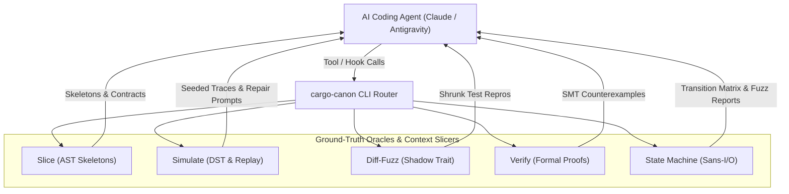

# `cargo-canon`


> **AI Ground-Truth Verification & Context Slicing Engine for Rust, Polyglot TypeScript & Go Codebases**

`cargo-canon` is a high-performance verification oracle and compiler-aware context delivery engine designed for large-scale Rust, polyglot TypeScript / TSX, and Go codebases (>1.2M LOC). It transforms AI coding agents (Claude, Antigravity, Cursor) from **unreliable open-loop generators** into **robust closed-loop engineers** by pairing them with deterministic simulation, differential fuzzing, bounded model proofs, cross-boundary contract verification, and out-of-band type skeleton slicing.

---

## The Core Problems, Approaches & Solutions

In large codebases, AI coding assistants suffer from four systemic failure modes. Here is how `cargo-canon` approaches and solves each one:

| Failure Mode | How `cargo-canon` Approaches It | Concrete Solution in `cargo-canon` |
|:---|:---|:---|
| **1. Context Dilution & Drift** | Compiler-aware AST slicing | `syn`, `oxc` & `tree-sitter-go` skeleton stripping + cross-boundary route indexing |
| **2. Tool Hook File Desync** | Out-of-band advisory delivery | Non-destructive post-read verification (`.rs`, `.ts`, `.tsx`, `.js`, `.jsx`, `.go`) |
| **3. Concurrency Flakiness** | Seeded deterministic runtime | Discrete-event DST + Go TSan/goleak sweep + AI repair prompts |
| **4. Shallow Test Hallucination** | Closed-loop adversarial testing | Diff-fuzzing (Rust, TS & Go Serde contracts), Kani, `proptest`, `fast-check` & `rapid` |

### 1. Context Window Dilution & Semantic Drift

- **The Problem:** Dumping raw source files into an LLM's context window leads to attention decay. The model loses track of trait bounds, drop semantics, lock hierarchies, and implicit contracts defined thousands of lines or dozens of files away, causing subtle semantic drift.
- **The Approach:** Instead of feeding raw implementation bodies to the model, extract a synthetic, compilable interface skeleton containing only the structural types, signatures, attributes, and contracts directly relevant to the task.
- **How `cargo-canon` Solves It:**
  - Employs a `syn::visit_mut::VisitMut` AST pass ([`canon-slice::skeleton`](crates/canon-slice/src/skeleton.rs)) that strips Rust function/method bodies in sub-milliseconds while preserving visibility, struct/enum layouts, trait definitions, and doc comments.
  - Employs an ultra-fast `oxc_parser` pass ([`canon-slice::ts_skeleton`](crates/canon-slice/src/ts_skeleton.rs)) that strips TypeScript and TSX function bodies, React hook internals (`useEffect`, `useState`), and JSX elements down to clean type signatures and exported interface contracts.
  - Employs a zero-copy `tree-sitter-go` pass ([`canon-slice::go_skeleton`](crates/canon-slice/src/go_skeleton.rs)) that strips Go function and method bodies down to type signatures, automatically resolving implicit interface contracts across value $\mathcal{M}(T)$ and pointer $\mathcal{M}(*T)$ receiver method sets.
  - Crawls call hierarchies and discovers all `impl Trait for Target` and Go structural interface contracts across the workspace, and correlates cross-boundary impact between Rust/Go API routes (Gin, Chi, Echo, `net/http`) and TypeScript client fetch calls and interfaces ([`canon-slice::indexer`](crates/canon-slice/src/indexer.rs)).
  - Achieves **>60%–85% token reduction**, giving the model 100% of the type and contract context with a fraction of the token consumption.

### 2. Tool Hook Desynchronization & Broken Patch Tools

- **The Problem:** Naive pre-read or post-read hooks that inject comments, annotations, or skeletons directly into target source files rewrite file contents on disk. This breaks line numbers and byte offsets, causing subsequent patch and diff editing tools (Claude Code, Antigravity) to fail with offset mismatches.
- **The Approach:** Maintain strict physical separation between on-disk target files and injected context.
- **How `cargo-canon` Solves It:**
  - Implements a **strictly non-destructive advisory tool hook** ([`canon-daemon::hook`](crates/canon-daemon/src/hook.rs)) supporting `.rs`, `.ts`, `.tsx`, `.js`, `.jsx`, and `.go`.
  - Emits all skeletons, contracts, call hierarchies, and cross-boundary impacts **exclusively out-of-band** (via stdout or Unix domain socket JSON-RPC).
  - Enforces a defensive post-read verification check: target source files are asserted byte-identical on disk before and after tool execution, ensuring zero offset drift.

### 3. Non-Deterministic Concurrency & Unreproducible Race Conditions

- **The Problem:** LLMs cannot mentally simulate complex async runtimes, thread schedules, mutex contention, or network packet reordering. Standard `cargo test` runs are non-deterministic and miss elusive race conditions.
- **The Approach:** Run async and distributed workflows inside a seeded, discrete-event simulation environment where simulated time, timers, scheduling, and network latency are 100% reproducible from a single 64-bit seed.
- **How `cargo-canon` Solves It:**
  - Integrates a Deterministic Simulation Testing (DST) engine ([`canon-harness::simulate`](crates/canon-harness/src/simulate/engine.rs)) with configurable fault injection (packet drop rates, latency stalls, deadlock bounds).
  - **Tier 1 Go Concurrency & Leak Sweep (`simulate --lang go`):** Executes zero-intrusion `go test -race` (ThreadSanitizer) paired with `uber-go/goleak` goroutine inspection across randomized `GOMAXPROCS` sweeps (`[1, 2, 4, 8]`), detecting data races and goroutine leaks without code refactoring.
  - Evaluates thousands of randomized seeds in seconds (`cargo canon simulate --seeds 5000`).
  - **100% Deterministic Replay:** Any failure reproduced from its exact seed (`cargo canon simulate --seed 0xDEADBEEF`).
  - **Adversarial AI Repair Prompt:** Automatically converts failing seeds, timeline traces, and goroutine leak stacks into actionable repair prompts for the agent.

### 4. Shallow Unit Testing Hallucinations

- **The Problem:** When prompted to test its own code, an LLM generates superficial happy-path tests (`assert_eq!(add(2, 2), 4)`), giving a false sense of security while edge cases, integer wraparounds, and dropped invariants escape into production.
- **The Approach:** Replace shallow unit test generation with automated, mathematically rigorous ground-truth verification: differential fuzzing, bounded model checking, and algebraic metamorphic properties across Rust, TypeScript, and Go contracts.
- **How `cargo-canon` Solves It:**
  - **Differential Fuzzing (`diff-fuzz`):** Wraps legacy and candidate implementations in a shadow-trait harness, checks millions of randomized operations, minimizes failing inputs, and exports standalone Rust `#[test]` reproducers. Also runs **Cross-Boundary Contract Fuzzing** verifying Serde $\leftrightarrow$ TypeScript $\leftrightarrow$ Go serialization (catching JS safe integer truncation, casing mismatches, nil slice vs empty slice serialization divergence, and optionality differences).
  - **Bounded Model Checking (`verify`):** Formally proves panic-freedom and invariant adherence across all bounded symbolic inputs via Kani, parsing SMT solver outputs into formatted Rust struct initializers.
  - **Metamorphic Invariant Testing (`invariants`):** Tests universal algebraic properties (Round-trip, Idempotence, Permutation Invariance, Monotonicity) powered by `proptest` (Rust), `fast-check` (TypeScript), and `pgregory.net/rapid` (Go).
  - **Sans-I/O Pure State Machines (`state-machine`):** Decouples domain logic from I/O, fuzzing state transitions at **>10,000,000 transitions/second** for Rust state machines, pure TypeScript reducers (`--ts-reducer`), and pure Go state machines (`--lang go` / `--go-state-machine`) with full reachability and dead-state analysis.

---

## Closed-Loop Verification Architecture



---

## The 6 Ground-Truth Pillars

### Pillar 1: Deterministic Simulation Testing (`simulate`)

- **Engine:** Seeded discrete-event simulator with virtual clock, message delivery queue, and fault injection.
- **Execution:** Run $N$ pseudo-random simulation passes (`cargo canon simulate --seeds 5000`).
- **Tier 1 Go Concurrency & Leak Oracle:** Zero-intrusion concurrency verification (`cargo canon simulate --lang go --seeds 100`) executing `go test -race` (TSan) paired with `uber-go/goleak` goroutine inspection across randomized `GOMAXPROCS` sweeps (`[1, 2, 4, 8]`), detecting data races and goroutine leaks without refactoring.
- **Reproducibility:** Replay any specific failure deterministically (`cargo canon simulate --seed 0x081e074d89bffda5`).
- **AI Feedback Loop:** Converts timeline traces and goroutine stacks directly into actionable repair instructions for the agent.

### Pillar 2: Differential Fuzzing Oracle & Cross-Boundary Oracles (`diff-fuzz`)

- **Pattern:** Dual-run shadow trait pattern comparing legacy reference vs. candidate implementation.
- **Cross-Boundary Contract Fuzzing:** Differentially fuzzes Serde models against TypeScript contracts and Go models (`--cross-boundary --rust-model <RustModel> --ts-type <TsType> --go-model <GoModel>`), detecting:
  - 64-bit integer precision loss beyond JavaScript `Number.MAX_SAFE_INTEGER` ($2^{53}-1$).
  - Naming discrepancies (`snake_case` in Rust vs. `camelCase` in TypeScript and Go).
  - Uninitialized nil slice vs. empty slice serialization divergence (Go `null` vs. TypeScript/Serde `[]`).
  - Optionality divergence (`Option::None` serializing to `null` vs. TypeScript expecting omitted `undefined`).
  - Enum tagging differences (externally tagged vs. untagged or internally tagged).
- **Shrinking:** Automatically minimizes failing operation sequences down to the smallest reproducing subset.
- **Export Reproducer:** Emits standalone, copy-pasteable Rust `#[test]`, companion TypeScript, and Go (`_test.go`) test reproducers (`--export-repro <PATH>`).

### Pillar 3: Proof-Carrying Patches via Model Checking (`verify`)

- **Engine:** Invokes `cargo kani` with JSON output parsing and unwind bounds (`--unwind 4`).
- **Counterexample Synthesis:** Parses raw SMT failures into concrete Rust struct initializers detailing the exact input state that triggered the failure.
- **Scaffolding:** Generates starter `#[kani::proof]` verification stubs (`--scaffold <SYMBOL>`).

### Pillar 4: Metamorphic Invariant Synthesis (`invariants`)

- **Concept:** Replaces shallow tests with algebraic property suites:
  - *Round-trip:* $f^{-1}(f(x)) \equiv x$
  - *Idempotence:* $f(f(x)) \equiv f(x)$
  - *Permutation Invariance:* $f(\text{shuffle}(x)) \equiv f(x)$
  - *Monotonicity / State Bounds:* State counters strictly increase or decrease.
- **Scaffolding:** Emits complete `proptest` suites for Rust, `fast-check` suites for TypeScript, and `pgregory.net/rapid` suites for Go models and state machines (`--scaffold <SYMBOL> --lang go`).

### Pillar 5: Sans-I/O Pure State Machine Framework (`state-machine`)

- **Purity:** Pure synchronous domain transitions (`step(&mut State, Event) -> Result<Vec<Action>, Error>`) with caller-injected deterministic time. `#![no_std]` compatible.
- **Throughput:** Benchmarked at **>10,000,000 transitions/second** with zero heap allocations in steady state.
- **TypeScript Reducer Fuzzing:** High-throughput transition fuzzing directly on pure TypeScript state reducers (`(state, action) => state`) via `--ts-reducer <PATH> --fuzz-transitions`.
- **Tier 2 Go State Machine Fuzzing:** Pure Sans-I/O discrete-event state machine fuzzing (`Step(State, Event) (State, []Action)`) at >1,000,000 transitions/sec via `--lang go` or `--go-state-machine <PATH>`.
- **Reachability Analysis:** Dumps complete transition tables and flags dead/unreachable states (`--matrix`).

### Pillar 6: Compiler-Aware Context Slicing (`slice`)

- **Extraction:** Sub-millisecond type skeleton extraction using `syn` (Rust), `oxc_parser` (TypeScript/TSX), and `tree-sitter-go` (Go), stripping function bodies, React hook internals, and JSX blocks while preserving visibility, exported types, interfaces, and doc comments.
- **Implicit Interface Resolution:** Computes Go value receiver $\mathcal{M}(T)$ and pointer receiver $\mathcal{M}(*T)$ method sets to resolve structural interface satisfaction across packages.
- **Graph Queries:** Explores upstream callers and downstream callees up to `--depth <N>`.
- **Contracts:** Extracts all `impl Trait for Target` blocks and Go interface contracts associated with the target type.
- **Cross-Boundary Correlation:** Discovers cross-boundary impact between Rust/Go backend routes/models and frontend TypeScript API call sites and consumer interfaces (`--cross-boundary`).
- **Prompt Bundling:** Formats LLM-ready markdown blocks with measured token reduction percentages.

---

## Installation & Quick Start

### Build and Install

```sh
# Clone repository
git clone https://github.com/your-org/cargo-canon.git && cd cargo-canon

# Build release binaries
make build

# Install into your Cargo binary directory (~/.cargo/bin)
cargo install --path crates/cargo-canon
```

Run either as a cargo subcommand (`cargo canon <COMMAND>`) or as a standalone binary (`canon <COMMAND>`).

---

## CLI Command Reference

### Context Slicing

```sh
# Stripped Rust type skeleton (default)
cargo canon slice src/engine.rs

# Stripped TypeScript / TSX type skeleton (strips JSX & hook internals)
cargo canon slice frontend/src/components/Dashboard.tsx

# Stripped Go type skeleton (resolves implicit interface satisfaction)
cargo canon slice backend/pkg/service/user.go

# Call hierarchy up to depth 3
cargo canon slice src/engine.rs --mode hierarchy --depth 3

# Trait and interface contracts (impl Trait for Target / Go structural satisfaction)
cargo canon slice src/engine.rs --mode contracts

# Cross-boundary impact correlation (Rust/Go backend <-> TS frontend)
cargo canon slice src/routes/users.rs --cross-boundary

# Complete LLM-optimized bundle in Markdown
cargo canon slice src/engine.rs --mode bundle --format markdown

# Machine-readable JSON output
cargo canon slice src/engine.rs --format json
```

### Deterministic Simulation Testing

```sh
# Run 5,000 randomized simulation passes
cargo canon simulate --seeds 5000

# Replay a specific seed deterministically
cargo canon simulate --seed 0x081e074d89bffda5

# Run Tier 1 Go concurrency & goroutine leak sweep (TSan + goleak)
cargo canon simulate --lang go --seeds 100 --ai-prompt-on-fail

# Configure fault rate and timeout bounds
cargo canon simulate --seeds 1000 --fault-rate 0.10 --max-ticks 20000

# Generate actionable prompt on failure
cargo canon simulate --seeds 5000 --ai-prompt-on-fail
```

### Differential Fuzzing

```sh
# Compare legacy vs candidate over 50,000 iterations
cargo canon diff-fuzz --target-trait KvStore --legacy LegacyMap --candidate CandidateMap --iterations 50000

# Cross-boundary Serde model vs TypeScript contract differential fuzzing
cargo canon diff-fuzz --cross-boundary --rust-model UpdateUserPayload --ts-type UpdateUserPayload

# Cross-boundary Serde model vs Go struct model differential fuzzing
cargo canon diff-fuzz --cross-boundary --go-model UserPayload --iterations 50000

# Automatically minimize and export #[test] reproducer
cargo canon diff-fuzz --iterations 10000 --export-repro tests/repro.rs
```

### Model Checking

```sh
# Run bounded proofs with loop unwinding depth 4
cargo canon verify --unwind 4

# Target specific proof harness
cargo canon verify --harness "verify_connection"

# Scaffold a starter #[kani::proof] stub
cargo canon verify --scaffold ConnectionEngine
```

### Metamorphic Invariants

```sh
# Run metamorphic property test suite
cargo canon invariants --run

# Scaffold proptest algebraic invariant suite (Rust)
cargo canon invariants --scaffold TransactionCoordinator --lang rust

# Scaffold fast-check property suite (TypeScript)
cargo canon invariants --scaffold UserStore --lang typescript

# Scaffold rapid property suite (Go)
cargo canon invariants --scaffold UserService --lang go
```

### Sans-I/O State Machine

```sh
# Transition matrix and dead-state analysis
cargo canon state-machine --matrix

# Pure Rust transition fuzzer (>10M transitions/sec)
cargo canon state-machine --fuzz-transitions --transitions 500000

# Pure TypeScript reducer fuzzer (>1M transitions/sec)
cargo canon state-machine --ts-reducer frontend/src/reducers/chat.ts --fuzz-transitions

# Pure Go state machine fuzzer (>1M transitions/sec)
cargo canon state-machine --lang go --transitions 500000
```

### Background Daemon & Agent Hooks

```sh
# Start background IPC daemon (auto-derives /tmp/canon-<hash>.sock per workspace/worktree)
cargo canon daemon --start

# Probe running daemon liveness and report round-trip latency
cargo canon daemon --ping

# Query running daemon status, index metrics, and cache statistics (supports --json)
cargo canon daemon --status

# Gracefully terminate the running background daemon
cargo canon daemon --stop

# Advisory post-read hook on Rust source file (emits provenance header)
cargo canon daemon --hook-post-read --file src/engine.rs

# Advisory post-read hook on TypeScript/TSX source file
cargo canon daemon --hook-post-read --file frontend/src/App.tsx

# Advisory post-read hook on Go source file
cargo canon daemon --hook-post-read --file backend/pkg/service/user.go
```

---

## Configuration (`.canon.toml`)

Place a `.canon.toml` file in your repository root:

```toml
[general]
codebase_scale = "massive"    # "small", "medium", "massive"
default_format = "markdown"   # "markdown", "json", "text"

[slice]
max_call_depth = 2
strip_comments = false
include_private_types = true

[simulate]
default_seeds = 5000
timeout_seconds = 30
panic_hook = "capture_backtrace"

[verify]
default_unwind = 4
solver = "kissat"             # "kissat", "cadical", "z3"

[diff_fuzz]
default_iterations = 50000
corpus_dir = "tests/fuzz/corpus"

[daemon]
# socket_path = "/tmp/canon.sock"  # Optional override; auto-derived per workspace/worktree if omitted
enable_file_watcher = true
watch_paths = ["crates", "frontend/src", "backend"]

[typescript]
enabled = true
tsconfig_path = "frontend/tsconfig.json"
extensions = ["ts", "tsx", "js", "jsx"]
strip_jsx = true
strip_hook_bodies = true

[go]
enabled = true
module_root = "backend"
extensions = ["go"]
strip_function_bodies = true
index_implicit_interfaces = true
include_private_types = false

[go.concurrency]
race_detector = true
goleak_check = true
gomaxprocs_sweep = [1, 2, 4, 8]
default_passes = 100

[go.state_machine]
fuzz_transitions = 100000
seed = "0x1337C0DECAFEE00D"

[cross_boundary]
rust_models = "crates/shared-types/src"
ts_types = "frontend/src/types"
go_models = "backend/pkg/models"
strict_casing_check = true
strict_omitempty_check = true
strict_nil_slice_check = true
```

Annotated template available in [`configs/.canon.toml`](configs/.canon.toml).

---

## Agent Tool Integration

### Claude Code (`.claude/config.json`)

Configure an advisory post-read hook:

```json
{
  "hooks": {
    "post_read": "cargo canon daemon --hook-post-read --file $FILE_PATH"
  }
}
```

For a step-by-step guide on integrating `cargo-canon` with your Rust and TypeScript project to improve Claude, see [`docs/instructions.md`](docs/instructions.md).

Pre-packaged configuration templates and starter kits are provided in the [`configs/`](configs/) folder:

- [`docs/instructions.md`](docs/instructions.md): Step-by-step setup guide for your codebase & Claude Code onboarding.
- [`configs/.canon.toml`](configs/.canon.toml): Full repository configuration template.
- [`configs/claude-config.json`](configs/claude-config.json): Claude Code hook setup.
- [`configs/ground-truth.yml`](configs/ground-truth.yml): GitHub Actions CI verification workflow.
- [`configs/pre-commit.sh`](configs/pre-commit.sh): Local git pre-commit hook script.

---

## Development & Makefile Workflow

```sh
make help              # List all available targets
make check             # Fast compile check (cargo check)
make test              # Run unit and integration tests
make sim               # Run deterministic simulation (5000 seeds)
make sim-replay SEED=  # Replay single seed (e.g. make sim-replay SEED=0xDEADBEEF)
make diff-fuzz         # Run differential fuzzing (50000 cycles)
make verify            # Run model checking / proof checks
make qa                # Strict QA: fmt-check -> clippy (-D warnings) -> loc check
make fmt               # Format code in-place
make loc               # Enforce 1,500 line limit per Rust source file
make clean             # Clean build artifacts
```

---

## License

This project is licensed under the [GNU Affero General Public License v3 (AGPL-3.0)](LICENSE).
