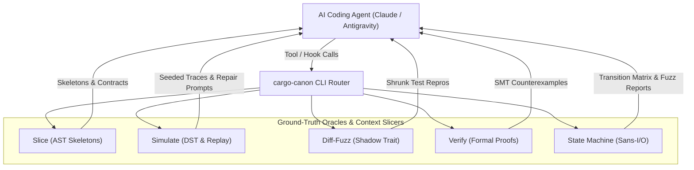

# `cargo-canon`

**AI Ground-Truth & Context Slicing Engine for Rust**

`cargo-canon` is a high-performance verification oracle and compiler-aware context provider designed for large-scale Rust codebases (>1.2M LOC). It eliminates AI model drift, hallucinated implementations, and context dilution by replacing passive LLM generation with closed-loop verification, deterministic simulation, and out-of-band type skeleton slicing.

---

## The Problem `cargo-canon` Solves

In massive codebases, AI coding agents (Claude, Antigravity, Cursor) face four critical failure modes:

1. **Context Window Dilution & Drift:** Dumping raw files into an agent's context window causes attention decay. Models lose track of trait bounds, drop semantics, and lock hierarchies defined thousands of lines away.
2. **File Desynchronization in Tool Hooks:** Naive pre/post-read hooks that inject comments or modify files on disk corrupt byte offsets and line numbers, causing subsequent patch and diff editing tools to fail.
3. **Unreproducible Concurrency Defects:** LLMs cannot mentally simulate async runtimes, race conditions, or network packet reordering. Standard unit tests fail to catch these non-deterministic bugs.
4. **Shallow Unit Test Hallucinations:** When prompted to test its own code, an LLM typically writes shallow, happy-path assertions that miss edge cases, integer overflows, and invariant violations.

`cargo-canon` resolves this by transforming the agent workflow into a **closed-loop verification loop**:



---

## Key Features

- **Compiler-Aware Context Slicing (`slice`)**: Sub-millisecond type skeleton extraction using `syn`, stripping function bodies to `/* implementation omitted */` while preserving signatures, attributes, and trait contracts (>60%–85% token reduction).
- **Deterministic Simulation Testing (`simulate`)**: Seeded async discrete-event simulation engine with virtual time, fault injection (network latency, message drops), deadlock detection, and automated AI prompt generation on failure.
- **Differential Fuzzing (`diff-fuzz`)**: Compares legacy reference implementations against candidate refactors across arbitrary input sequences with automated test case minimization (`--export-repro`).
- **Bounded Model Checking (`verify`)**: Formal verification runner parsing Kani SMT solver failures into structured Rust struct counterexamples, plus starter proof stub scaffolding.
- **Metamorphic Invariant Synthesis (`invariants`)**: Discovers and tests algebraic properties (round-trip, idempotence, permutation invariance, monotonicity) instead of shallow unit tests.
- **Sans-I/O State Machine Fuzzing (`state-machine`)**: High-throughput pure state machine runner capable of **>10,000,000 transitions/second**, with full reachability and dead-state matrix reporting.
- **Non-Destructive Advisory Sidecar (`daemon`)**: Background IPC daemon with file watching (`notify`) providing sub-millisecond agent tool hook execution while keeping source files strictly byte-identical on disk.

---

## Installation

### From Source

Ensure you have Rust installed (Rust 2024 / 1.85.0+):

```sh
# Clone the repository
git clone https://github.com/your-org/cargo-canon.git && cd cargo-canon

# Build release binaries
make build

# Install into your Cargo binary directory (~/.cargo/bin)
cargo install --path crates/cargo-canon
```

Once installed, the CLI can be invoked either as a cargo subcommand (`cargo canon <COMMAND>`) or as a standalone binary (`canon <COMMAND>`).

---

## CLI Usage & Commands

### 1. Context Slicing (`cargo canon slice`)

Extracts compact, compiler-accurate context without loading unneeded implementation bodies.

```sh
# Extract stripped interface skeleton (default)
cargo canon slice src/engine.rs

# Extract upstream callers and downstream callees up to depth 3
cargo canon slice src/engine.rs --mode hierarchy --depth 3

# Extract trait implementations (impl Trait for Target)
cargo canon slice src/engine.rs --mode contracts

# Generate complete LLM-optimized bundle in Markdown
cargo canon slice src/engine.rs --mode bundle --format markdown

# Output structured JSON for machine integration
cargo canon slice src/engine.rs --format json
```

Example output:

```markdown
# Canon Context Slice: `src/engine.rs`
> **Token Reduction:** 74.2% context saved vs raw source.

## Type Skeleton & Interface Contracts
```rust
pub struct Engine {
    pub id: u64,
}

impl Engine {
    pub fn new(id: u64) -> Self;
    pub fn start(&self) -> Result<(), EngineError>;
}
```

---

### 2. Deterministic Simulation Testing (`cargo canon simulate`)

Runs workloads under simulated time, randomized scheduling, and fault injection.

```sh
# Run 5,000 randomized simulation passes
cargo canon simulate --seeds 5000

# Replay a specific failure deterministically from a 64-bit seed
cargo canon simulate --seed 0x081e074d89bffda5

# Configure fault injection rate and maximum virtual ticks
cargo canon simulate --seeds 1000 --fault-rate 0.10 --max-ticks 20000

# Automatically emit an actionable prompt for Claude / AGY on failure
cargo canon simulate --seeds 5000 --ai-prompt-on-fail
```

When an invariant fails, `cargo-canon` formats the timeline and exact seed into an adversarial repair prompt:

```text
# Canon Deterministic Simulation Testing (DST) Oracle: Bug Report

- **Reproducible Seed:** `0x081e074d89bffda5`
- **Failure Tick:** 15
- **Violation:** `SequenceInvariantViolated: PayloadReady received before Handshake acknowledged`

## Execution Timeline Trace
[tick 00005] FAULT INJECTED: dropped message 'HandshakeSyn' destined for actor 1
[tick 00010] FAULT INJECTED: dropped message 'HandshakeAck' destined for actor 2
[tick 00015] DELIVERED: 'PayloadReady' to actor 1

## Instructions for AI Agent
1. Reproduce this exact defect locally with `cargo canon simulate --seed 0x081e074d89bffda5`.
2. Analyze the timeline trace above for reordering, race condition, or dropped message handling.
3. Surgically patch the coordination state machine to preserve safety under this fault.
```

---

### 3. Differential Fuzzing (`cargo canon diff-fuzz`)

Verifies that a refactored candidate implementation behaves identically to a legacy baseline across arbitrary operations.

```sh
# Differentially fuzz legacy vs candidate over 50,000 operation cycles
cargo canon diff-fuzz --target-trait KvStore --legacy LegacyMap --candidate CandidateMap --iterations 50000

# Automatically minimize divergence and export a standalone Rust #[test] reproducer
cargo canon diff-fuzz --iterations 10000 --export-repro tests/repro_divergence.rs
```

---

### 4. Bounded Model Checking (`cargo canon verify`)

Runs formal model checking via `kani` and synthesizes structured counterexamples.

```sh
# Run bounded proofs with loop unwind depth 4
cargo canon verify --unwind 4

# Target specific proof harness
cargo canon verify --harness "verify_connection_state"

# Scaffold a starter #[kani::proof] stub for a struct or function
cargo canon verify --scaffold ConnectionCoordinator
```

---

### 5. Metamorphic Invariant Testing (`cargo canon invariants`)

Tests universal algebraic properties (Round-trip, Idempotence, Permutation Invariance, Monotonicity).

```sh
# Run metamorphic property test suite
cargo canon invariants --run

# Scaffold a complete proptest metamorphic test suite for a domain type
cargo canon invariants --scaffold TransactionCoordinator
```

---

### 6. Sans-I/O State Machine Fuzzing (`cargo canon state-machine`)

Executes high-throughput transition fuzzing and reachability analysis on pure state machines.

```sh
# Dump state transition table, reachability report, and flag dead states
cargo canon state-machine --matrix

# Fuzz 500,000 state transitions at >10,000,000 transitions/sec
cargo canon state-machine --fuzz-transitions --transitions 500000
```

---

### 7. Agent Sidecar & Tool Hook Daemon (`cargo canon daemon`)

Background service providing near-instant responses for AI agent integrations.

```sh
# Start background daemon on /tmp/canon.sock
cargo canon daemon --start

# Specify custom socket path
cargo canon daemon --start --socket /tmp/my-project-canon.sock

# Execute advisory post-read tool hook (strictly preserves target file unmodified)
cargo canon daemon --hook-post-read --file src/engine.rs
```

#### Non-Destructive Advisory Context Injection Invariant
>
> **CRITICAL:** `cargo canon daemon --hook-post-read` delivers skeletons, contracts, and call hierarchies **exclusively out-of-band** (via stdout or JSON IPC). Source files on disk are guaranteed strictly byte-identical, ensuring line numbers and byte offsets in AI patch/diff editing tools remain 100% accurate.

---

## Configuration (`.canon.toml`)

Configure default behaviors in the repository root by adding a `.canon.toml` file:

```toml
[general]
codebase_scale = "massive"    # "small", "medium", "massive"
default_format = "markdown"   # "markdown", "json", "text"

[slice]
max_call_depth = 2
strip_comments = false
include_private_types = true

[simulate]
default_seeds = 5000
timeout_seconds = 30
panic_hook = "capture_backtrace"

[verify]
default_unwind = 4
solver = "kissat"             # "kissat", "cadical", "z3"

[diff_fuzz]
default_iterations = 50000
corpus_dir = "tests/fuzz/corpus"

[daemon]
socket_path = "/tmp/canon.sock"
enable_file_watcher = true
```

---

## Agent Integration Examples

### Claude Code Tool Configuration

Add a post-read hook to `.claude/config.json` or your tool wrapper script:

```json
{
  "hooks": {
    "post_read": "cargo canon daemon --hook-post-read --file $FILE_PATH"
  }
}
```

Because the output is delivered out-of-band to stdout, Claude receives the type skeleton and trait contracts as advisory context without modifying the actual source file on disk.

### Antigravity / Agent CLI Tool Call

```sh
# Fetch minimal interface context for a file before generating patches
cargo canon slice crates/canon-slice/src/lib.rs --format markdown
```

---

## Development & Testing Workflow

Run workspace tasks using `make`:

```sh
make help              # List all available targets
make check             # Fast workspace compilation check
make test              # Run full unit and integration test suite
make sim               # Run deterministic simulation testing (5000 seeds)
make sim-replay SEED=  # Replay a specific seed (e.g. make sim-replay SEED=0xDEADBEEF)
make diff-fuzz         # Run differential fuzzing harness (50000 cycles)
make verify            # Run model checking or proof verification
make qa                # Strict QA: fmt-check -> clippy (-D warnings) -> loc check
make fmt               # Format code in-place
make loc               # Enforce 1,500 line limit per Rust source file
make clean             # Clean build artifacts
```
